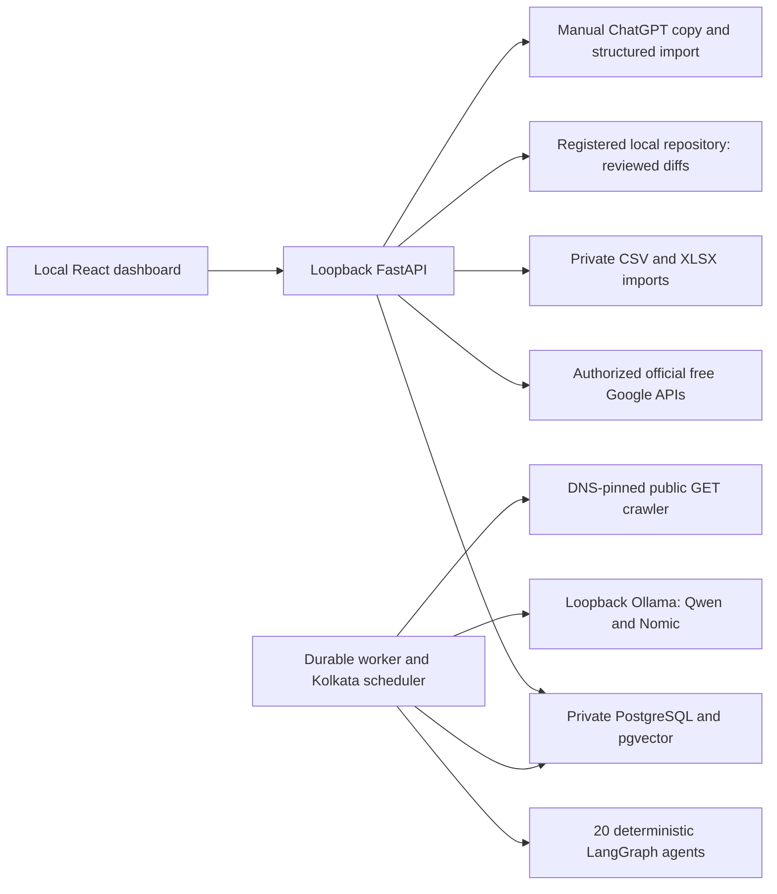

# Zero-cost local SEO architecture

Implemented 29 November 2026 in `seo-growth-ai/` on `work/zero-cost-seo-platform`, based on `9bbf4ea`. This new application does not replace or deploy the existing Django website. The preceding website SEO changes remain separate.

## Running system

React, TypeScript, Tailwind and lazy Recharts use the authenticated same-origin API. FastAPI/Pydantic validate requests. SQLAlchemy and three frozen Alembic revisions store tenants, users, source sets, metrics, crawl history, documents, 768-dimension vectors, agent states, actions, jobs, schedules, reports, notifications and approved proposals. Runtime secrets, original uploads, database files, models and backups are ignored by Git.

The verified native profile uses PostgreSQL 18/pgvector, Ollama and one Python worker. The worker also checks schedules every minute. Optional Celery solo worker + Beat + authenticated Valkey has been exercised on the same database; durable SQL jobs remain the source of truth. Do not run both executors together. Linux Compose, Prometheus and Grafana configurations are supplied but container execution was not tested because no Docker daemon is available here.

## Evidence and recommendations

GSC import sets explicitly reference their own dimensions, even when an identical chart is reused. Missing dimensions/dates stay unknown. CTR comes from summed clicks/impressions. Position combined from rounded daily values is marked approximate. Joined query/page evidence is distinguished from lexical page suggestions; overlap is a cannibalization review candidate, never proof. The default 3% CTR scenario describes an assumption at unchanged impressions; it is not a forecast. Business relevance, average position, demand, effort and sample confidence contribute to the documented score in `app/analytics.py`.

Twenty persisted agents run bounded rules through LangGraph. Missing GA4, competitor, backlink, indexing or AI-visibility inputs produce blocked/partial states. Content, AEO/GEO, local and conversion reviews retain their evidence limits. Public competitor pages can be added as separate websites; their schedules start disabled. Imported links/referrals provide incomplete partnership candidates; no outreach is sent. An AI referral is not an AI citation.

Ollama serves explicitly downloaded local models. Invalid/unavailable model output falls back to deterministic suggestions. Generated drafts have a strict schema, require review and have no tools or publication permission. Local Nomic embeddings and lexical TF-IDF provide tenant/site-filtered hybrid retrieval. Captured pages, supplied documents, bounded GSC reference extracts and generated reports enter the versioned knowledge store. Indexing is explicit, in batches of at most 16; unchanged content reuses chunks/vectors. Google sync metrics remain in structured tables; arbitrary official documentation/company facts can be added with provenance and an explicit owner verification flag.

## Permission boundaries

- Argon2 passwords, server-side hashed session tokens, HttpOnly SameSite cookies, CSRF and Origin/Host checks, login throttling and session revocation on password change.
- Tenant/site scope on records and jobs; viewer writes denied. Whole-instance backup is restricted to the initial installation owner. Host resource totals remain host-wide; user AI counters are tenant-scoped.
- Google credentials use a private Fernet key. OAuth uses PKCE, expiring one-use state and the initiating local session. Official API methods/paths and quotas are restricted; no paid fallback exists.
- Public fetches require all DNS answers to be public, pin the actual IP with original SNI/Host, revalidate redirects, reject private destinations, and bound response sizes/hops. Robots, sitemap/page limits and per-host delay apply. No restricted Google search scraping.
- Browser lab traffic is limited to the selected public hostname and standard ports; writes, third-party requests, WebSockets, private paths and tracking routes are blocked. Measurements explicitly describe these constraints.
- Models and external page text cannot run shell commands, change source, submit sitemaps or deploy. Manual ChatGPT imports require matching website/export/source IDs and a one-use token; recommendations become reviewable actions.
- Repository access requires an OS-owner registration of an exact configured root. Proposals reject sensitive/hidden/generated paths, symlinks, stale hashes, ambiguous replacements and potential secrets. Applying requires approval and a clean feature branch. Static checks do not establish application behavior; framework tests must be reviewed separately. Rollback is limited to the unchanged proposal branch/HEAD/file. Draft PR publication is an explicit CLI operation with separate authorization and free-public-CI guards.

## Automation and operations

Six daily slots use Asia/Kolkata: 06:00 sync; 07:00 keyword/CTR analysis; 08:00 actions; 11:00 bounded important-page crawl; 17:00 content/link analysis; 20:00 report. Monday 09:00 runs an incremental crawl followed by a weekly review/report. The first day of each month at 09:30 runs the full available-evidence review. Analysis slots include all twenty agents. URL inspection still requires authorized Google input; a crawl is not an indexing verdict. Competitor fetches require a separately permitted crawl.

Unique persisted due-slot keys prevent duplicate catch-up. A restart coalesces each schedule to its latest due slot after creation. Running jobs have leases/recovery and crawl checkpoints. Nothing runs while the computer is off. Native service stop validates ownership/PID creation time and leaves existing system Redis and website services alone.

Private bearer-protected Prometheus metrics, structured metadata-only HTTP/job logs, resource snapshots, local notifications and reports provide operational evidence. ZIP backups contain a PostgreSQL dump, original uploads and checksums; runtime secrets and the master key are excluded. The restore exercise creates and drops only a uniquely named database inside this app's own private cluster. Pause writers during backup/restore verification. Media lab screenshots/models are regenerable and are not included.

## Cost contract and limits

The five mandatory policy values cannot be relaxed: free-only true, paid APIs false, external API budget INR 0, cloud provisioning false and automatic paid upgrade false. No billing accounts/trials/cloud resources were created. Local electricity, network access, disk use and pre-existing website hosting are not fabricated as free or metered savings. The dashboard reports external expenditure as unknown because no billing feed exists, and separately shows the enforced zero API budget.

Free data cannot reproduce a comprehensive backlink index, complete competitor SERPs, reliable keyword volume/CPC/difficulty, complete indexing coverage, automatic commercial AI citations or a traffic guarantee. OAuth credentials/property access, owner-verified business facts and real conversion definitions must be supplied by their owners. See `FREE_INTEGRATIONS.md` and `FINAL_TEST_REPORT.md`.
